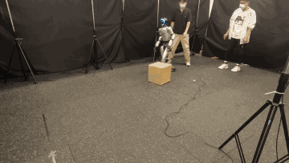
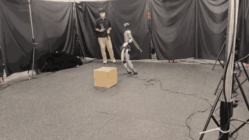
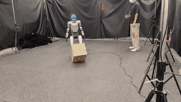
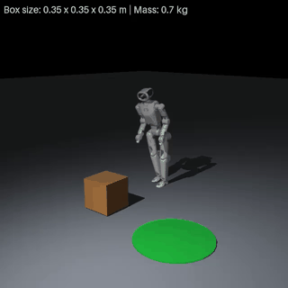
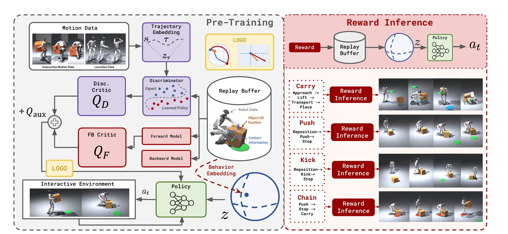
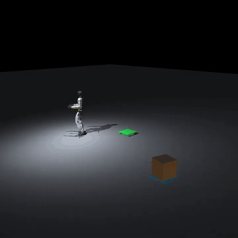
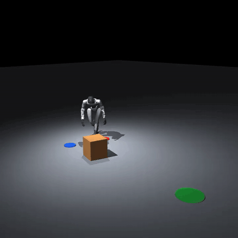
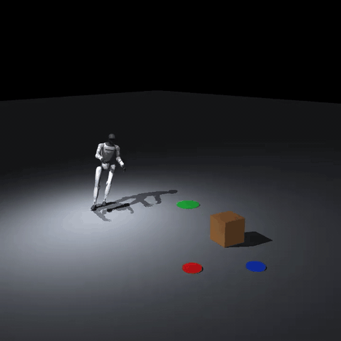

<h1 align="center">I-BFM: Reward-Conditioned Robust Humanoid Interaction via Unsupervised Reinforcement Learning</h1>

<p align="center">
  <a href="https://iamhardworking.github.io/I-BFM/">[Project website]</a>
  <a href="https://arxiv.org/abs/2610.06129">[Paper]</a>
  <a href="https://github.com/LeCAR-Lab/BFM-Zero">[BFM-Zero upstream]</a>
</p>

<p align="center"></p>

[English](README.md) · [简体中文](README.zh-CN.md)

This repository provides the G1 H200 training source, the selected **166.560M-step checkpoint**, and interactive configurations for **Carry Box**, **Push Box**, and **Kick Box**. The G1 task scripts use the same checkpoint. RP1 training configurations and a simulation video are also included.

## Project videos

Click a preview to watch the full video on the project website.

| Carry Box | Push Box | Kick Box |
| :---: | :---: | :---: |
| [](https://iamhardworking.github.io/I-BFM/#robust-carry-box) | [](https://iamhardworking.github.io/I-BFM/#robust-push-box) | [](https://iamhardworking.github.io/I-BFM/#robust-kick-box) |

### RP1 Carry Box

[](assets/rp1/carry-box.mp4)

See [RP1 details](ibfm/docs/RP1_TRAINING.md) for model and scene settings.

## Method overview



## Contents

| Path | Contents |
| --- | --- |
| `ibfm/` | Training source and task runtime dependencies |
| `ibfm/tasks/carry_box/` | Carry Box interactive script, controller, and latents |
| `ibfm/tasks/push_box/` | Push Box interactive script, controller, and latents |
| `ibfm/tasks/kick_box/` | Kick Box interactive scripts, controller, and latents |
| `checkpoints/ibfm-166m/` | Selected checkpoint and metadata |
| [`deploy/g1_carry_box_166m/`](deploy/g1_carry_box_166m/) | G1 Carry Box real-robot deployment, 166.560M ONNX actor, solve-close latents, calibration, and gamepad control |
| [`ibfm/docs/RP1_TRAINING.md`](ibfm/docs/RP1_TRAINING.md) | RP1 official-PD configuration, motion-cache manifest, training commands, and CPU replay |

## Setup

Linux, Python 3.10, `uv`, Git LFS, and MuJoCo are required. Install the repository and restore the checkpoint:

```bash
git clone https://github.com/Roboparty/I-BFM-Code.git
cd I-BFM-Code
git lfs install
git lfs pull
bash restore_checkpoint.sh
cd ibfm
uv sync
```

## Training configuration

After setup, run training on eight H200 GPUs from `ibfm/`:

```bash
./scripts/train_ibfm_h200.sh ibfm_reproduction
```

The launcher uses the published data mix, seed, and training parameters. `runs/ibfm_reproduction/checkpoint/` is the rolling resumable checkpoint. `policies/latest` points to the latest completed policy; `policies/best` points to the policy with the lowest mean EMD across all 2,719 evaluation motions. These policy copies contain weights and configuration, without optimizer or replay data. The replay buffer is written once, in the final rolling checkpoint, when training finishes normally.

To resume after an interruption:

```bash
RESUME=1 ./scripts/train_ibfm_h200.sh ibfm_reproduction
```

Without a replay buffer from the same step, the continued run will differ from an uninterrupted run.

### CPU Replay For 48 GB GPUs

The training CLI supports `--buffer-device cpu` to store online replay and expert
buffers in host RAM while keeping the model and training batches on GPU. This
reduces VRAM use for GPUs such as the 4090 48 GB, with additional host memory and
transfer costs. The RP1 launcher accepts `BUFFER_DEVICE=cpu`, as shown below;
the CLI default remains `auto`. See [memory details](ibfm/docs/RP1_TRAINING.md#cpu-replay-for-48-gb-gpus).

## RP1 Training

RP1 uses official PD gains, full domain randomization and LAFAN/Carry/Kick
sampling weights 30/40/30. After preparing the six RP1 caches, run from `ibfm/`:

```bash
PYTHONPATH=. .venv/bin/python scripts/check_rp1_training.py
CUDA_VISIBLE_DEVICES=0,1,2,3,4,5,6,7 BUFFER_DEVICE=cpu \
  bash scripts/train_rp1.sh rp1_official_pd_250m
```

Defaults are eight GPUs, 512 environments per GPU and 250M total steps. See
[RP1 training details](ibfm/docs/RP1_TRAINING.md) for data installation, parameters,
checkpoint/replay saving, disk requirements and resume commands.

## Interactive tasks

Run these commands from `ibfm/` after setup. The scripts create their own output directories for videos, traces, and summaries.

### Carry Box

```bash
./tasks/carry_box/run_interactive.sh
```



### Push Box

```bash
./tasks/push_box/run_interactive.sh
```



### Kick Box

```bash
./tasks/kick_box/run_interactive.sh
```



## Replay buffer

The [166.560M-step replay buffer](https://huggingface.co/datasets/HanSj77/I-BFM-166560M-replay-buffer) is available on Hugging Face (eight rank-local shards, about 210 GiB total). Download it from `ibfm/`:

```bash
uvx --from huggingface_hub hf download HanSj77/I-BFM-166560M-replay-buffer --repo-type dataset \
  --local-dir runs/ibfm_166560m_replay
```

Each `runs/ibfm_166560m_replay/checkpoint/buffers/train_rank_0/` through `train_rank_7/` directory contains `buffer.hdf5` and `config.json`. The existing `TrajectoryDictBufferMultiDim.load()` reader in `humanoidverse/agents/buffers/trajectory.py` loads one shard:

```bash
./.venv/bin/python - <<'PY'
from humanoidverse.agents.buffers.trajectory import TrajectoryDictBufferMultiDim

path = "runs/ibfm_166560m_replay/checkpoint/buffers/train_rank_0"
buffer = TrajectoryDictBufferMultiDim.load(path, device="cpu")
print(buffer.size())
PY
```

This loads the entire selected shard into memory (about 28 GB on disk). The buffer supports latent selection during reward inference; pass a single rank directory to `humanoidverse/reward_inference.py` with `--buffer-path`.

## Community

To discuss I-BFM, LOGO, reproductions, and humanoid interaction, scan the QR code below to add the author on WeChat.

<p align="center"></p>

## License

The training source retains its upstream CC BY-NC 4.0 license. See [LICENSE](LICENSE).

## Citation

If you find this project useful in your research, please cite the [I-BFM paper](https://arxiv.org/abs/2610.06129):

```bibtex
@misc{han2026ibfm,
  title         = {{I-BFM}: Reward-Conditioned Robust Humanoid Interaction via Unsupervised Reinforcement Learning},
  author        = {Ziqi Han and Yitang Li and Junhan Sun and Fanrong Dong and Yaojie Shen and Lei Ye and Zetong Jing and Yongqi Zhang and Yiming Zhang and Xue Wang and Hao Zhao},
  year          = {2026},
  eprint        = {2610.06129},
  archivePrefix = {arXiv},
  primaryClass  = {cs.RO},
  url           = {https://arxiv.org/abs/2610.06129}
}
```
