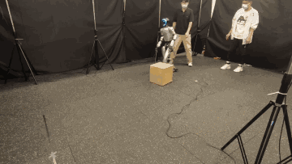
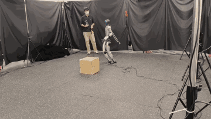
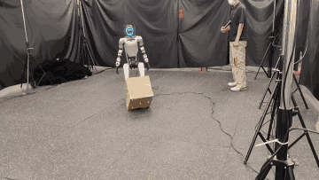
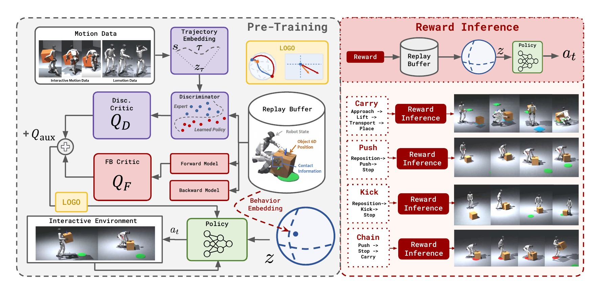
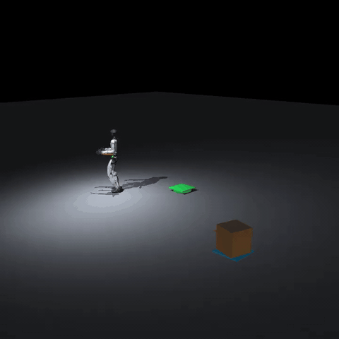
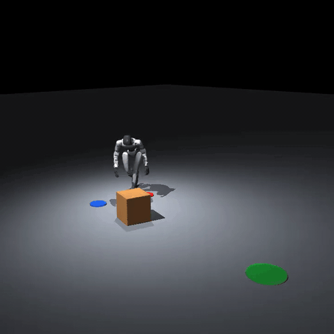
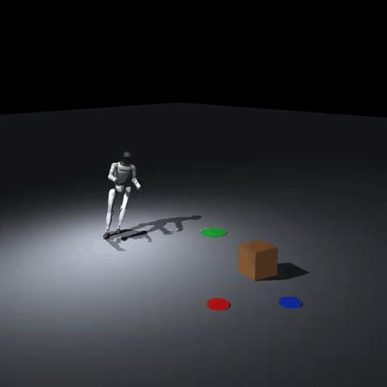

<h1 align="center">I-BFM: Reward-Conditioned Robust Humanoid Interaction via Unsupervised Reinforcement Learning</h1>

<p align="center">
  <a href="https://iamhardworking.github.io/I-BFM/">[项目网站]</a>
  <a href="https://arxiv.org/abs/2610.06129">[论文]</a>
  <a href="https://github.com/LeCAR-Lab/BFM-Zero">[BFM-Zero 上游代码]</a>
</p>

<p align="center"></p>

[English](README.md) · [简体中文](README.zh-CN.md)

本仓库提供 H200 训练源码、选定的 **166.560M 步权重**，以及 **Carry Box（搬箱）**、**Push Box（推箱）** 和 **Kick Box（踢箱）** 的交互配置。三个任务使用同一份权重。仓库保留了训练实现和输入文件，以支持复现。

## 项目视频

点击预览可在项目网站观看完整视频。

| Carry Box（搬箱） | Push Box（推箱） | Kick Box（踢箱） |
| :---: | :---: | :---: |
| [](https://iamhardworking.github.io/I-BFM/#robust-carry-box) | [](https://iamhardworking.github.io/I-BFM/#robust-push-box) | [](https://iamhardworking.github.io/I-BFM/#robust-kick-box) |

## 方法概览



## 仓库内容

| 路径 | 内容 |
| --- | --- |
| `ibfm/` | 训练源码和任务运行依赖 |
| `ibfm/tasks/carry_box/` | 搬箱交互脚本、控制器和 latent 向量 |
| `ibfm/tasks/push_box/` | 推箱交互脚本、控制器和 latent 向量 |
| `ibfm/tasks/kick_box/` | 踢箱交互脚本、控制器和 latent 向量 |
| `checkpoints/ibfm-166m/` | 选定的权重及其元数据 |

## 安装

需要 Linux、Python 3.10、`uv`、Git LFS 和 MuJoCo。克隆仓库、下载文件并还原权重：

```bash
git clone https://github.com/Roboparty/I-BFM-Code.git
cd I-BFM-Code
git lfs install
git lfs pull
bash restore_checkpoint.sh
cd ibfm
uv sync
```

## 训练配置

完成安装后，在 `ibfm/` 目录使用 8 张 H200 训练：

```bash
./scripts/train_ibfm_h200.sh ibfm_reproduction
```

启动脚本使用发布版的数据配比、随机种子和训练参数。`runs/ibfm_reproduction/checkpoint/` 是可恢复训练的滚动检查点；`policies/latest` 指向最新策略，`policies/best` 指向 2,719 条评估动作的平均 EMD 最低的策略。这两份策略只包含权重与配置，不包含优化器和 replay buffer。训练正常结束时，replay buffer 只写入最终滚动检查点一次。

若训练中断，可从滚动模型与优化器续训：

```bash
RESUME=1 ./scripts/train_ibfm_h200.sh ibfm_reproduction
```

因缺少同期 replay buffer，续训轨迹会与不中断的训练不同。

## 交互任务

完成安装后，在 `ibfm/` 目录运行以下命令。脚本会自行创建目录，保存视频、轨迹和运行摘要。

### Carry Box（搬箱）

```bash
./tasks/carry_box/run_interactive.sh
```



### Push Box（推箱）

```bash
./tasks/push_box/run_interactive.sh
```



### Kick Box（踢箱）

```bash
./tasks/kick_box/run_interactive.sh
```



## Replay buffer

[166.560M 步的 replay buffer](https://huggingface.co/datasets/HanSj77/I-BFM-166560M-replay-buffer) 已上传至 Hugging Face，包含 8 个 rank 的数据，总计约 210 GiB。在 `ibfm/` 目录下载：

```bash
uvx --from huggingface_hub hf download HanSj77/I-BFM-166560M-replay-buffer --repo-type dataset \
  --local-dir runs/ibfm_166560m_replay
```

下载后，`runs/ibfm_166560m_replay/checkpoint/buffers/train_rank_0/` 至 `train_rank_7/` 每个目录都包含 `buffer.hdf5` 和 `config.json`。现有的 `humanoidverse/agents/buffers/trajectory.py` 中的 `TrajectoryDictBufferMultiDim.load()` 可以读取单个 rank：

```bash
./.venv/bin/python - <<'PY'
from humanoidverse.agents.buffers.trajectory import TrajectoryDictBufferMultiDim

path = "runs/ibfm_166560m_replay/checkpoint/buffers/train_rank_0"
buffer = TrajectoryDictBufferMultiDim.load(path, device="cpu")
print(buffer.size())
PY
```

这会将选定的整个文件读入内存（单个文件约 28 GB）。该 buffer 提供用于进行 reward inference 中 latent 的选取；可在 `humanoidverse/reward_inference.py` 中通过 `--buffer-path` 指定单个 rank 的目录。

## 社区交流

欢迎加入 **Party-BFM 微信交流群**，交流 I-BFM、LOGO、复现与人形机器人交互。扫描下方二维码入群；邀请过期后我们会更新图片。

<p align="center"></p>

## 许可

训练源码沿用上游的 CC BY-NC 4.0 许可，详见 [LICENSE](LICENSE)。

## 引用

如果本项目对你的研究有帮助，请引用 [I-BFM 论文](https://arxiv.org/abs/2610.06129)：

```bibtex
@misc{han2026ibfm,
  title         = {{I-BFM}: Reward-Conditioned Robust Humanoid Interaction via Unsupervised Reinforcement Learning},
  author        = {Ziqi Han and Yitang Li and Junhan Sun and Fanrong Dong and Yaojie Shen and Lei Ye and Zetong Jing and Yongqi Zhang and Yiming Zhang and Xue Wang and Hao Zhao},
  year          = {2026},
  eprint        = {2610.06129},
  archivePrefix = {arXiv},
  primaryClass  = {cs.RO},
  url           = {https://arxiv.org/abs/2610.06129}
}
```
